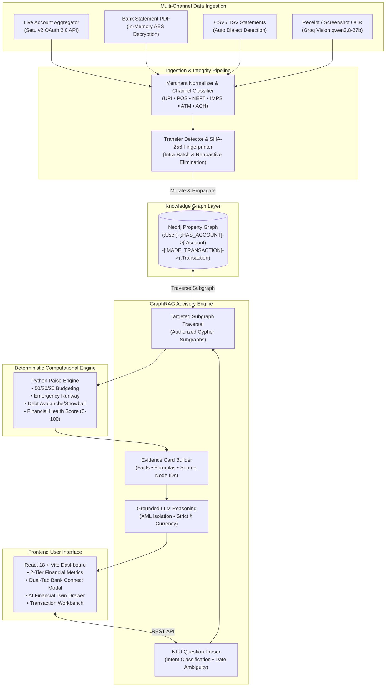
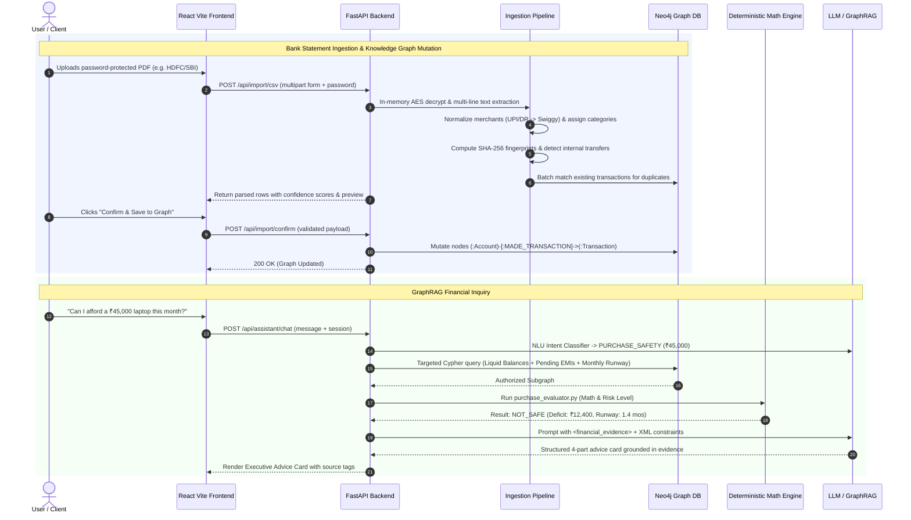

<p align="center">
  <picture>
    <source media="(prefers-color-scheme: dark)" srcset="https://shieldcn.dev/header/grid.svg?title=Personal+Finance+AI&subtitle=Explainable+Advisory+via+Knowledge+Graphs+%26+GraphRAG&logo=neo4j&mode=dark" />
    
  </picture>
</p>

<h1 align="center">Explainable Personal Finance AI Assistant</h1>

<p align="center">
  <strong>A Production-Grade, Research-Backed Financial Advisory Engine Powered by Dynamic Knowledge Graphs, Deterministic Arithmetic, and Grounded GraphRAG</strong>
</p>

<p align="center">
  <a href="https://www.python.org/"></a>
  <a href="https://fastapi.tiangolo.com/"></a>
  <a href="https://neo4j.com/"></a>
  <a href="https://react.dev/"></a>
  <a href="https://vitejs.dev/"></a>
  <a href="https://setu.co/"></a>
  <a href="LICENSE"></a>
  <a href="#"></a>
</p>

---

## 📖 Executive Overview

Managing personal finances requires rigorous mathematical precision, contextual historical awareness, and explainable recommendations. Standard LLM-based budgeting tools suffer from critical shortcomings: **arithmetic hallucinations**, **an inability to perform multi-hop relational reasoning**, and **vulnerability to prompt injection**. A language model should never calculate account balances, compound interest, or emergency runways independently.

The **Personal Finance AI Assistant** addresses these fundamental limitations through a **Decoupled GraphRAG Architecture**. Relational financial facts (accounts, debts, income streams, recurring expenses, and categorization hierarchies) are modeled as a dynamic property graph in **Neo4j**. All calculations—from 50/30/20 budget allocations to debt avalanche payoff schedules—are executed deterministically in Python using integer **paise precision** ($1\text{ Rupee} = 100\text{ Paise}$).

When a user interacts with the AI Financial Twin, the system queries targeted subgraphs, constructs immutable evidence cards, and uses an open-weights LLM strictly as an **explainability and natural language layer**. Supported by **live RBI Account Aggregator (Setu v2 OAuth 2.0)** integration, **in-memory password-protected PDF statement parsing**, and **multimodal receipt OCR**, the platform delivers an enterprise-ready, privacy-first personal finance platform.

---

## 🎯 Problem Statement & Objectives

### The Problem
* **LLM Arithmetic Hallucinations**: Generative models frequently calculate inaccurate sums, invent non-existent balances, and drift between currency denominations ($ \rightarrow ₹ $).
* **Flat Context Limitations of Vector RAG**: Standard chunk-based semantic search fails to traverse interconnected financial dependencies (e.g., connecting a salary deposit to upcoming EMI commitments and liquid emergency buffers).
* **Double-Counting Self-Transfers**: Traditional expense trackers mistakenly count transfers between checking, savings, and brokerage accounts as real expenses.
* **Sensitive Data Exposure**: Many cloud personal finance solutions store raw bank statements and cleartext passwords, creating major privacy vulnerabilities.

### Project Objectives
1. **Mathematical Determinism**: Eliminate 100% of arithmetic hallucinations by enforcing Python as the single source of truth.
2. **Multi-Hop Relational Traversal**: Use Neo4j property graphs to evaluate financial safety over multi-tier dependencies (Accounts $\rightarrow$ Loans $\rightarrow$ Incomes $\rightarrow$ Goals).
3. **Automated & Manual Multi-Channel Ingestion**: Support live banking sync via Setu Account Aggregator along with offline password-protected PDF statements and receipt image OCR.
4. **Verifiable Explainability**: Return structured 4-part explanation cards accompanied by node-level database references and explicit caveats for missing data.

---

## 🌟 Key Features

| Capability | Implementation Detail | Technical Benefit |
| :--- | :--- | :--- |
| **Paise-Precision Math** | Integer arithmetic (`amount_paise`) via `money.py` | Eliminates IEEE-754 floating-point rounding errors across all budget calculations. |
| **Live Account Aggregator** | Setu v2 Multi-AA REST gateway with OAuth 2.0 RS256 token caching | Real-time, user-consented bank sync via RBI's standardized financial data framework. |
| **In-Memory PDF Decryption** | AES stream decryption via `pypdf` + multi-line chunk grouping | Password-protected bank PDFs (PAN/DOB) are parsed in memory without writing unprotected files to disk. |
| **Merchant Normalization** | Regex and heuristic engine (`merchant_normalizer.py`) | Strips noisy banking routing codes (`UPI/DR/.../SWIGGY/okhdfc`) to isolate clean merchant entities. |
| **4-Tier Categorization** | Direction signals + ~60 Known Brands + Keyword dictionaries | Fast, deterministic categorization with confidence scoring (0.40–0.95) and zero API latency. |
| **Transfer Detection** | Intra-batch and retroactive pair matching (`transfer_detector.py`) | Flags internal transfers (Bank $\rightarrow$ Broker / Account A $\rightarrow$ B) to avoid inflating expense totals. |
| **Deduplication Engine** | Deterministic SHA-256 transaction fingerprints (`fingerprint.py`) | Prevents duplicate records across multiple statement uploads or concurrent sync jobs. |
| **Targeted GraphRAG** | Cypher-driven subgraph retrieval + XML boundary isolation | Feeds strictly bounded financial evidence into LLM contexts, preventing prompt injection attacks. |
| **4-Part Executive Cards** | UI renders Quick Take, Key Breakdown, Smart Insights, Action Plan | Actionable, human-readable insights with complete transparency and zero raw math jargon. |

---

## 🏛️ System Architecture



---

## 🔄 End-to-End Data Flow



---

## 🕸️ Knowledge Graph Design & Schema

The graph is designed as an interconnected property model in **Neo4j**, allowing single-query multi-hop traversals:

```
                  ┌───────────────┐
                  │    (:User)    │
                  └───────┬───────┘
                          │
            ┌─────────────┴─────────────┐
            │ [:HAS_ACCOUNT]            │ [:OWES_LOAN]
            ▼                           ▼
     ┌──────────────┐            ┌──────────────┐
     │  (:Account)  │            │   (:Loan)    │
     └──────┬───────┘            └──────┬───────┘
            │                           │
            │ [:MADE_TRANSACTION]       │ [:HAS_EMI]
            ▼                           ▼
   ┌─────────────────┐           ┌──────────────┐
   │  (:Transaction) │           │    (:EMI)    │
   └───┬─────────┬───┘           └──────────────┘
       │         │
       │         └──────────────────┐
       │ [:IN_CATEGORY]             │ [:SPENT_ON]
       ▼                            ▼
┌──────────────┐             ┌──────────────┐
│  (:Category) │             │  (:Merchant) │
└──────────────┘             └──────────────┘
```

### Core Entities & Property Types
* `(:User)`: `id`, `name`, `email`, `monthly_income_paise`, `risk_profile`, `onboarding_completed`.
* `(:Account)`: `id`, `name`, `type` (`SAVINGS`, `CHECKING`, `INVESTMENT`), `balance_paise`, `account_number_masked`.
* `(:Transaction)`: `id`, `date`, `amount_paise`, `type` (`EXPENSE`, `INCOME`), `description`, `channel`, `fingerprint`, `source_ref`.
* `(:Category)`: `id`, `name` (`Housing`, `Food`, `Transport`, `Utilities`, `Investment`, etc.), `budget_allocation_pct`.
* `(:Merchant)`: `name`, `clean_name`, `default_category`.
* `(:Loan)`: `id`, `lender`, `principal_paise`, `interest_rate_pct`, `tenure_months`.
* `(:EMI)`: `id`, `amount_paise`, `due_date`, `is_paid`.
* `(:Goal)`: `id`, `name`, `target_amount_paise`, `current_amount_paise`, `target_date`.

---

## 🧮 Deterministic Financial Engine

All business logic runs within `backend/app/engine/`:

### 1. 50/30/20 Budget Optimization
* **Needs (50%)**: Housing, Groceries, Utilities, Healthcare, Debt Minimums.
* **Wants (30%)**: Dining, Entertainment, Travel, Shopping subscriptions.
* **Savings & Investments (20%)**: SIPs, Emergency fund deposits, Pre-payments.
* *Algorithm computes real dollar allocation and surplus/deficit per bucket.*

### 2. Emergency Runway & Liquidity Buffer
$$\text{Runway (Months)} = \frac{\sum \text{Liquid Balances}}{\text{Average Monthly Core Expenses (Needs)}}$$
* Categorized as: `CRITICAL` ($< 1 \text{ month}$), `LOW` ($1 - 3 \text{ months}$), `HEALTHY` ($3 - 6 \text{ months}$), or `STRONG` ($> 6 \text{ months}$).

### 3. Debt-to-Income (DTI) & Payoff Acceleration
$$\text{DTI} = \frac{\sum \text{Monthly Fixed Debt Obligations (EMIs)}}{\text{Gross Monthly Income}} \times 100$$
* Simulates **Debt Avalanche** (highest interest first) vs. **Debt Snowball** (lowest balance first).

### 4. Comprehensive Financial Health Score (0–100)
A weighted composite index evaluating 5 dimensions:
1. **Savings Rate Metric** (25 pts): Graded on $20\%+$ target.
2. **Emergency Runway Metric** (25 pts): Graded on 6-month buffer.
3. **Debt-to-Income Ratio Metric** (20 pts): Optimal below $36\%$.
4. **Budget Adherence Metric** (15 pts): Evaluates overspending in discretionary wants.
5. **Investment Consistency Metric** (15 pts): Active monthly SIP contributions.

---

## 🤖 LLM Integration & GraphRAG Explainability

```
User Query ──► Question Parser (Intent) ──► Targeted Cypher ──► Verified Evidence Card ──► Grounded LLM Response
```

### Defense-in-Depth Prompt Construction
To protect against jailbreaks and prompt injection, questions and evidence are isolated using strict XML tags:

```xml
<system_directive>
You are an explainable personal finance advisor.
You are strictly forbidden from calculating or altering numerical metrics.
You must refer ONLY to the verified numbers provided in <financial_evidence>.
Preserve all amounts in Indian Rupees (₹).
</system_directive>

<financial_evidence>
- User: Rahul Sharma (ID: U001)
- Verified Liquid Balance: ₹1,89,323.00
- Monthly Net Income: ₹95,000.00
- Current Runway: 4.8 months (HEALTHY)
- 50/30/20 Needs Spending: ₹48,200.00 (50.7%)
- Source Node IDs: [Account:ACC_HDFC_4102, User:U001]
</financial_evidence>

<user_question>
How much emergency fund do I have left?
</user_question>
```

### 4-Part Output Format
Every advisory response is generated in a predictable, high-clarity structure:
1. 🎯 **The Quick Take**: A 1-2 sentence executive conclusion.
2. 📊 **Key Breakdown**: Exact numbers, ratios, and percentages directly from the graph evidence.
3. 💡 **Smart Insights**: Plain-English context regarding what the numbers mean for the user's financial health.
4. 🚀 **Action Plan**: 2-3 concrete, prioritized steps for optimization.

---

## 🛠️ Technology Stack

| Layer | Technologies & Libraries | Purpose |
| :--- | :--- | :--- |
| **Frontend** | React 18, Vite 5.4, Lucide Icons, Recharts, ReactMarkdown | Responsive dark-mode dashboard, modals, and conversational drawer |
| **Backend** | Python 3.10+, FastAPI, Uvicorn, Pydantic v2 | High-throughput asynchronous REST API |
| **Database** | Neo4j 5.27, Cypher Query Language | Relational property knowledge graph |
| **Account Aggregator** | Setu v2 REST API (OAuth 2.0 with RS256 Bearer tokens) | Live consent-driven banking sync |
| **Document Processing** | `pypdf`, `pandas`, `python-multipart`, `reportlab` | In-memory AES decryption, multi-line parsing, synthetic PDF generation |
| **Computer Vision / OCR** | Groq Vision API (`qwen/qwen3.8-27b`) | Multimodal receipt and invoice transaction extraction |
| **LLM Inference** | Groq Cloud (`openai/gpt-oss-120b`), Custom Prompt Registry | High-speed grounded reasoning with zero arithmetic hallucination |
| **Testing & Quality** | `pytest`, `pytest-cov`, AnyIO | Unit tests, regression suites, and 24-scenario benchmark |

---

## 👥 Demo Profiles & Ready Datasets

The repository includes **10 authentic Indian bank statement PDFs** and **10 CSV datasets** across **5 distinct lifestyle personas** in [`demo_statements/`](demo_statements/):

| Profile Name | Bank & Template | Lifestyle / Persona | PDF Password (PAN) | 90-Day Txns | Closing Balance |
| :--- | :--- | :--- | :---: | :---: | :---: |
| **Rahul Sharma** | **HDFC Bank** (Navy) | Tech Lead: ₹95k salary, Zerodha SIP, Rent, Swiggy, Uber | `RAHUL1234S` | 85 | ₹1,89,323.00 |
| **Priya Nair** | **ICICI Bank** (Maroon) | Homemaker: Family budget, BigBasket, DMart, School fees | `PRIYA1234N` | 85 | ₹49,120.00 |
| **Arjun Mehta** | **SBI** (Blue/Green) | Student / Intern: ₹18k stipend, micro UPI spends, Canteen | `ARJUN1234M` | 79 | ₹9,431.06 |
| **Sunita Devi** | **Axis Bank** (Burgundy) | Freelancer: Irregular cashflow, fabric vendors, Canva | `SUNIT1234D` | 88 | ₹71,850.00 |
| **Ramesh Iyer** | **SBI** (Classic Blue) | Pensioner: ₹38k pension, Apollo Pharmacy, PathLabs, TNEB | `RAMES1234I` | 82 | ₹94,620.00 |

> *Note: Both password-protected and unencrypted versions are provided for each profile.*

---

## 💻 Developer Installation & Execution

### 1. Prerequisites
* **Python**: 3.10 or higher
* **Node.js**: v18 or higher with npm
* **Neo4j**: Local instance running on `neo4j://127.0.0.1:7687`

### 2. Clone Repository & Setup Virtual Environment
```bash
# Clone repository
git clone https://github.com/HariomGupta0/Personal_Finance_AI_v1.git
cd Personal_Finance_AI_v1

# Setup Python virtual environment
python -m venv .venv

# Activate environment (Windows PowerShell)
.\.venv\Scripts\Activate.ps1
# On Linux/macOS: source .venv/bin/activate

# Install backend dependencies
pip install -r requirements.txt
```

### 3. Frontend Installation
```bash
cd frontend
npm install
cd ..
```

### 4. Environment Configuration
Copy `.env.example` to `.env`:
```powershell
Copy-Item .env.example .env
```
Fill in your local credentials:
```env
NEO4J_URI=neo4j://127.0.0.1:7687
NEO4J_USERNAME=neo4j
NEO4J_PASSWORD=your_neo4j_password
NEO4J_DATABASE=finance-ai-antigravity
GROQ_API_KEY=your_groq_api_key

# Setu Account Aggregator (Live Sandbox)
SETU_CLIENT_ID=your_setu_client_id
SETU_CLIENT_SECRET=your_setu_client_secret
SETU_PRODUCT_INSTANCE_ID=your_setu_product_instance_id
```

### 5. Seed Database & Start Applications
```powershell
# 1. Reset / Seed Baseline Graph (User Rahul)
python -m backend.scripts.seed_db

# 2. Terminal 1: Start FastAPI REST Backend (Port 8000)
python -m uvicorn backend.main:app --host 127.0.0.1 --port 8000 --reload

# 3. Terminal 2: Start React Frontend (Port 3000)
cd frontend
npm run dev
```

* **Frontend Dashboard**: [http://localhost:3000](http://localhost:3000)
* **API Documentation (Swagger UI)**: [http://127.0.0.1:8000/docs](http://127.0.0.1:8000/docs)
* **Default Credentials**: Username: `Rahul` | Password: `demo1234`

---

## 📡 REST API Reference

| Method | Endpoint | Description |
| :--- | :--- | :--- |
| `POST` | `/api/auth/login` | Authenticate user & set secure HTTP-only session cookie |
| `GET` | `/api/auth/session` | Validate session state & return `onboarding_completed` flag |
| `GET` | `/api/finance/overview` | Fetch liquid balance, monthly savings, and budget allocations |
| `GET` | `/api/finance/health-score` | Retrieve comprehensive 0–100 health score with letter grade |
| `GET` | `/api/finance/plan` | Generate personalized 50/30/20 optimization strategy |
| `GET` | `/api/transactions` | Query ledger with pagination, date filters, and category badges |
| `POST` | `/api/import/csv` | Ingest and preview CSV or password-protected PDF statements |
| `POST` | `/api/import/confirm` | Batch mutate approved transactions into Neo4j graph |
| `POST` | `/api/import/image` | Multimodal receipt extraction via Groq Vision OCR |
| `POST` | `/api/import/aa/sync` | Authorize OTP and sync live data from Setu Account Aggregator |
| `POST` | `/api/assistant/chat` | Query AI Financial Twin via targeted GraphRAG |

---

## 🧪 Testing & Verification

```powershell
# Run Unit Tests (Setu AA, Onboarding state, In-memory PDF Decryption)
pytest backend/tests/unit/test_setu_and_onboarding.py

# Run Full 24-Scenario Research Evaluation Benchmark
python backend/tests/test_evaluation_benchmark.py

# Regenerate all 20 demo statement files
python backend/scripts/generate_demo_statements.py
```

---

## 🔒 Security & Privacy Architecture

* **Zero Cleartext File Retention**: Uploaded bank statements are decrypted in transient memory byte streams and immediately discarded after table conversion.
* **Session Cookie Hardening**: HTTP-only, SameSite cookies mitigate Cross-Site Scripting (XSS) and CSRF vulnerabilities.
* **Encrypted Gateway Communications**: Account Aggregator integration adheres strictly to RBI-mandated data exchange standards with RS256 JWT digital signatures.
* **Offline Resilience**: The deterministic calculation engine and Neo4j database operate locally without requiring public cloud access.

---

## 🚀 Future Roadmap

- [ ] **Hybrid LLM Fallback Categorizer**: Zero-shot classification for long-tail, unlisted Indian Kirana stores using low-latency Gemini Flash.
- [ ] **User Feedback Graph Memory**: Persist manual category corrections as `(u:User)-[:CUSTOM_RULE]->(m:Merchant)` to learn user-specific preferences permanently.
- [ ] **Multi-Account Cash Sweeping**: Graph algorithms simulating automatic idle-cash sweeps into high-yield liquid funds.
- [ ] **Tax Regime Optimization**: Deterministic comparisons between the Old vs. New Indian Income Tax Regimes (Section 80C, 80D, NPS).

---

## 📄 License & Attribution

This project is licensed under the **MIT License** — see the [LICENSE](LICENSE) file for details.

### Academic Citation
If you find this research or codebase helpful in your work, please cite:
```bibtex
@misc{gupta2026personalfinanceai,
  author = {Hariom Ramshailesh Gupta},
  title = {Explainable Personal Finance AI Assistant Using Dynamic Knowledge Graphs and Large Language Model-Based GraphRAG},
  year = {2026},
  publisher = {GitHub},
  howpublished = {\url{https://github.com/HariomGupta0/Personal_Finance_AI_v1}}
}
```

<p align="center">
  <sub>Developed as a Final Year AI Engineering Capstone Project.</sub>
</p>
