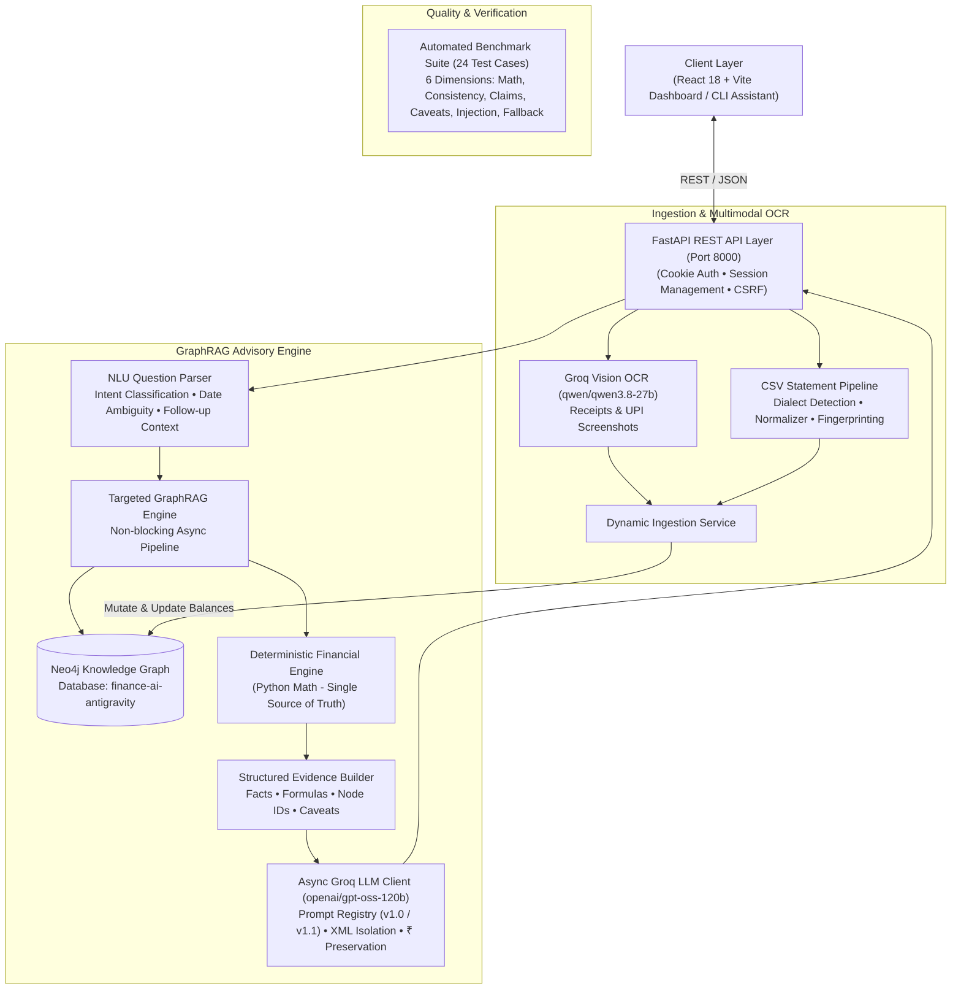

# System Architecture: Personal Finance AI Assistant
### *Dynamic Knowledge Graphs, Deterministic Reasoning, and Grounded GraphRAG*

## 1. End-to-End Architectural Overview

---

## 2. Core Architectural Pillars

1. **Deterministic Financial Math as Single Source of Truth**:
   The LLM is **never** permitted to calculate, recalculate, or make financial safety judgments. All arithmetic (savings rate, runway, emergency buffer, purchase safety, and financial health scores) is executed deterministically in Python ([financial_engine.py](file:///c:/Users/gupta/Documents/HARIOM/Personal_Finance_AI_FYP/backend/app/engine/financial_engine.py)).

2. **Dynamic Knowledge Graph (Neo4j)**:
   Financial data is stored as a connected property graph (`finance-ai-antigravity`). Relationships link accounts, incomes, transactions, categories, loans, and goals. Dynamic mutations update account balances and recalculate metrics immediately.

3. **Targeted GraphRAG Subgraph Traversal**:
   Rather than dumping raw text or monolithic database dumps into LLM context, [graph_rag.py](file:///c:/Users/gupta/Documents/HARIOM/Personal_Finance_AI_FYP/backend/app/rag/graph_rag.py) retrieves only the authorized, relevant nodes and relationships matching the query intent.

4. **Defense-in-Depth & Prompt Injection Protection**:
   User questions and conversation histories are enclosed within explicit XML boundary tags (`<user_question>`, `<conversation_history>`) and treated as untrusted data. The LLM is instructed that only `<financial_evidence>` contains authoritative financial facts.

5. **Strict Currency Preservation**:
   All monetary amounts are strictly formatted and preserved in Indian Rupees (`₹`), with zero conversion drift to foreign currencies.

---

## 3. Component Design & Layer Responsibilities

### 1. Presentation Layer (`frontend/`)
* **Technology**: React 18, Vite, Lucide Icons, Recharts, ReactMarkdown.
* **Dashboard View**: Real-time KPI summaries (Savings Rate, Runway, Net Savings, Health Score) and expenditure charts.
* **Assistant Chat**: Conversational interface parsing structured 4-section executive cards:
  - 🎯 **The Quick Take**: Bottom-line conclusion.
  - 📊 **Key Breakdown**: Verified figures and metrics.
  - 💡 **Smart Insights**: Practical implications without raw math formulas.
  - 🚀 **Action Plan**: Tailored next steps.
* **Transaction & Import Manager**: Full transaction ledger with live filtering, CSV bank statement ingestion, and drag-and-drop receipt OCR.

### 2. API & Security Layer (`backend/app/api/`)
* **Session-Based Authentication** ([auth.py](file:///c:/Users/gupta/Documents/HARIOM/Personal_Finance_AI_FYP/backend/app/api/auth.py)): Signed HTTP-only session cookies with configurable TTL and CSRF safeguards.
* **Assistant Router** ([assistant.py](file:///c:/Users/gupta/Documents/HARIOM/Personal_Finance_AI_FYP/backend/app/api/assistant.py)): Async query routing, session memory caching, and prompt version inspection.
* **Finance & Transactions** ([finance.py](file:///c:/Users/gupta/Documents/HARIOM/Personal_Finance_AI_FYP/backend/app/api/finance.py), [transactions.py](file:///c:/Users/gupta/Documents/HARIOM/Personal_Finance_AI_FYP/backend/app/api/transactions.py)): Authorized CRUD operations with real-time balance propagation.
* **Import Router** ([import_api.py](file:///c:/Users/gupta/Documents/HARIOM/Personal_Finance_AI_FYP/backend/app/api/import_api.py)): Multimodal receipt extraction and batch statement processing.

### 3. NLU & Extraction Layer (`backend/app/nlu/`)
* **Question Parser** ([question_parser.py](file:///c:/Users/gupta/Documents/HARIOM/Personal_Finance_AI_FYP/backend/app/nlu/question_parser.py)): Intent extraction across 8 core financial intents, relative and ambiguous date detection, and multi-turn context retention.
* **Transaction Extractor** ([transaction_extractor.py](file:///c:/Users/gupta/Documents/HARIOM/Personal_Finance_AI_FYP/backend/app/nlu/transaction_extractor.py)): Regex and heuristic extractor paired with Groq Vision OCR for image receipts.

### 4. GraphRAG & Retrieval Pipeline (`backend/app/rag/`)
* **Targeted Subgraph Retrieval**: Cypher queries selecting only the nodes necessary for the query intent.
* **Evidence Construction**: Serializes grounded facts, formula references, reporting dates, and missing-data caveats.
* **Non-Blocking Async LLM**: Calls `ask_llm_async()` with exponential backoff retries and telemetry logging.

### 5. Deterministic Engine (`backend/app/engine/`)
* **Calculations**:
  - Savings Rate & Net Savings
  - Emergency Fund Shortfall (3-month baseline)
  - Emergency Runway (in months) & status
  - Debt-to-Income (DTI) ratio & deduplicated EMI obligations
  - Purchase Safety evaluation (SAFE / NOT_SAFE with risk level)
  - Comprehensive Financial Health Score (0–100) and letter grade (A+ to D)

### 6. Automated Benchmark Suite (`backend/app/evaluation/`)
* 24 automated research tests evaluating 6 key dimensions:
  1. Numerical Correctness
  2. Status Consistency (rejection of hallucinated contradictions)
  3. Rejection of Unsupported / Phantom Numbers
  4. Reporting Period Integrity & Missing Data Caveats
  5. Prompt Injection Defense
  6. Graceful Deterministic Fallback Handling
