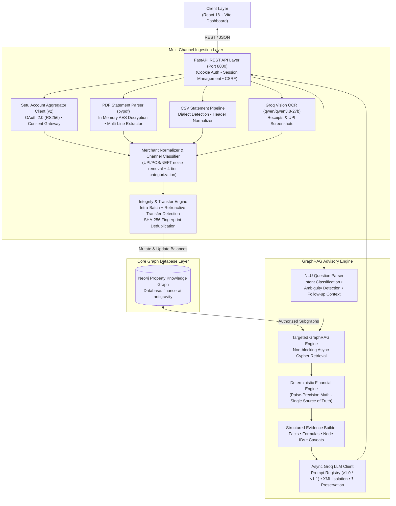

# System Architecture: Personal Finance AI Assistant
### *Dynamic Knowledge Graphs, Deterministic Reasoning, and Grounded GraphRAG*

---

## 1. End-to-End Architectural Overview

---

## 2. Core Architectural Pillars

### 1. Deterministic Financial Math as Single Source of Truth (Paise Precision)
* The LLM is **never** permitted to calculate, recalculate, or make financial judgments independently.
* All arithmetic (50/30/20 budget allocations, savings rate, runway, emergency buffer, purchase safety, and financial health scores) is executed deterministically in Python ([financial_engine.py](file:///c:/Users/gupta/Documents/HARIOM/Personal_Finance_AI_FYP/backend/app/engine/financial_engine.py)).
* **Paise Precision (`money.py`)**: All database operations and computations convert Rupee amounts into integer paise (`amount_paise`), eliminating IEEE-754 floating-point rounding errors.

### 2. Live Account Aggregator (Setu v2 OAuth 2.0 Integration)
* Integrates directly with the **RBI Account Aggregator** framework via Setu's v2 REST APIs ([setu_client.py](file:///c:/Users/gupta/Documents/HARIOM/Personal_Finance_AI_FYP/backend/app/services/setu_client.py)).
* **Authentication**: Automatic OAuth 2.0 Bearer token retrieval from `https://uat.setu.co/api/v2/auth/token` with in-memory caching and proactive refresh before expiry.
* **Consent Routing**: Dispatches ReBIT-compliant consent requests (`POST https://fiu-sandbox.setu.co/v2/consents`) with standardized VUA handles (`@finvu`), fetching encrypted 90-day bank data upon user OTP authorization.

### 3. In-Memory Decryption & Bank Statement PDF Parsing
* Many Indian bank e-statements (HDFC, SBI, ICICI, Axis) are password-protected with the user's PAN or Date of Birth.
* [pdf_parser.py](file:///c:/Users/gupta/Documents/HARIOM/Personal_Finance_AI_FYP/backend/app/services/pdf_parser.py) performs **in-memory byte-stream AES decryption** using `pypdf`, guaranteeing unencrypted bank statements are **never written to disk**.
* **Multi-Line Extraction**: Accommodates wrapped Indian bank statement lines where transaction dates, narrations, debits, credits, and balances span multiple adjacent lines.

### 4. Merchant Normalization & 4-Tier Categorization
Indian banking narrations are notoriously noisy (e.g., `UPI/DR/603207903267/SWIGGY/okhdfcbank/Order`).
[merchant_normalizer.py](file:///c:/Users/gupta/Documents/HARIOM/Personal_Finance_AI_FYP/backend/app/services/merchant_normalizer.py) operates a 4-tier pipeline:
1. **Channel & Noise Stripping**: Identifies channels (`UPI`, `POS`, `NEFT`, `IMPS`, `ATM`, `ACH/NACH`) and removes RRNs, bank codes, and terminal noise.
2. **Directional Signal Check**: Credits matching income patterns (`salary`, `dividend`, `refund`, `cashback`) map to `Income` (Confidence: 0.90).
3. **High-Confidence Known Brands (`KNOWN_MERCHANTS`)**: Maps ~60 major Indian merchants (`Swiggy`, `Zomato`, `Uber`, `Amazon`, `CRED`, `Zerodha`) with 0.95 confidence.
4. **Keyword Dictionary Fallbacks**: Classifies broader keywords (`rent`, `petrol`, `pharmacy`, `wifi`, `tuition`) with 0.75 confidence. Unmatched narrations assign `General` (Confidence: 0.40).

### 5. Internal Transfer Detection & Deduplication
* **Self-Transfer Elimination** ([transfer_detector.py](file:///c:/Users/gupta/Documents/HARIOM/Personal_Finance_AI_FYP/backend/app/services/transfer_detector.py)): Budgets are distorted when users transfer money between their own accounts (e.g., HDFC $\rightarrow$ Zerodha or Account A $\rightarrow$ Account B). The engine scans intra-batch and retroactive pairs matching amounts within a $\pm 1$ day window, flagging them as transfers to **prevent double-counting as expenses**.
* **Deterministic SHA-256 Fingerprinting** ([fingerprint.py](file:///c:/Users/gupta/Documents/HARIOM/Personal_Finance_AI_FYP/backend/app/services/fingerprint.py)): Encodes `(account_id, date, amount_paise, type, clean_merchant, occurrence_index)` to detect duplicate uploads reliably.

### 6. Dynamic Knowledge Graph (Neo4j)
Financial entities are modeled as an interconnected property graph:
`(:User)-[:HAS_ACCOUNT]->(:Account)-[:MADE_TRANSACTION]->(:Transaction)-[:IN_CATEGORY]->(:Category)`.
Account mutations immediately update balance nodes and propagate across all financial KPIs without database restarts.

### 7. Targeted GraphRAG Subgraph Traversal
Rather than dumping monolithic tables or flat text into LLM contexts, [graph_rag.py](file:///c:/Users/gupta/Documents/HARIOM/Personal_Finance_AI_FYP/backend/app/rag/graph_rag.py) retrieves only the authorized, relevant nodes and relationships matching the query intent.

---

## 3. Component Design & Layer Responsibilities

### 1. Presentation Layer (`frontend/src/components/`)
* **Technology**: React 18, Vite, Lucide Icons, Recharts, ReactMarkdown.
* **`ConnectBankModal.jsx`**: Dual-tab modal providing automated Setu Account Aggregator sync alongside instant password-protected PDF/CSV statement upload with live table preview.
* **`OnboardingWizardModal.jsx`**: 4-step wizard for new users (Salary, Rent, Bank account details) with deterministic persistence.
* **`AssistantChat.jsx`**: Conversational AI Financial Twin parsing 4-part structured advice cards (Quick Take, Key Breakdown, Smart Insights, Action Plan).
* **`KPICards.jsx` & `ExpenseAnalytics.jsx`**: Real-time KPI summaries (Savings Rate, Emergency Runway, Net Savings, 50/30/20 breakdown, Health Score).
* **`TransactionManager.jsx` & `ImportManager.jsx`**: Transaction ledger with live category filtering, receipt OCR editing workbench, and batch approval.

### 2. API & Security Layer (`backend/app/api/`)
* **`auth.py`**: Cookie session authentication (`/session`, `/login`, `/signup`, `/logout`) returning verified `onboarding_completed` flags.
* **`import_api.py`**: Shared ingestion endpoint (`/api/import/csv`, `/api/import/image`, `/api/import/aa/sync`) running unified validation, deduplication, and Neo4j mutations.
* **`finance.py` & `transactions.py`**: Authorized calculation endpoints (50/30/20 plan, DTI, Emergency Fund, Health Score) and transaction CRUD operations.
* **`assistant.py`**: Non-blocking async GraphRAG conversational routing.

### 3. Deterministic Financial Engine (`backend/app/engine/`)
* **`financial_engine.py`**: Single source of mathematical truth for Savings Rate, Emergency Runway, DTI, and Financial Health Score (0–100).
* **`plan_generator.py`**: Implements 50/30/20 budget allocations, debt avalanche/snowball payoff sequencing, and personalized optimization advice.
* **`purchase_evaluator.py`**: Evaluates purchase safety (`SAFE`, `CAUTION`, `NOT_SAFE`) based on liquid balance, upcoming EMIs, and essential buffers.

### 4. GraphRAG & LLM Engine (`backend/app/rag/`)
* **Prompt Registry & XML Boundary Isolation**: Encloses user prompts in `<user_question>` and financial context in `<financial_evidence>`.
* **Circuit Breaker**: Detects provider timeouts or network partitions, gracefully falling back to deterministic local rule responses without crashing.
* **Zero Currency Hallucination**: Enforces complete preservation of `₹` denominations with zero currency drift.

---

## 4. Security & Privacy Guarantees

1. **No Cleartext PDF Storage**: Uploaded statement files are held in transient memory buffers during parsing and immediately discarded after table conversion.
2. **Session Cookie Isolation**: HTTP-only, SameSite cookies protect session IDs against Cross-Site Scripting (XSS).
3. **Encrypted Gateway Communications**: Setu AA tokens and communications use TLS 1.3 with RS256 JWT digital signatures.
4. **Offline Resilience**: If the internet or third-party LLM providers are unreachable, the local rule engine and Neo4j database continue to deliver 100% accurate mathematical dashboards and advice.
