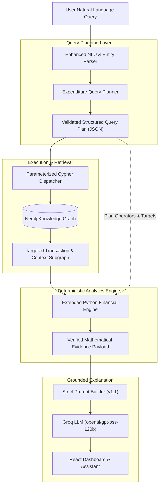

# Audit Report: Expenditure Intelligence Architecture & Capabilities
### *Explainable Personal Finance AI Assistant Using Dynamic Knowledge Graph and LLM*

**Document Version:** 1.0  
**Audit Date:** October 19, 2026  
**Auditor Mode:** Audit-First Inspection (Read-Only Analysis)  
**Target Repository:** `Personal_Finance_AI_FYP`  

---

## 1. Executive Summary & Audit Methodology

This audit evaluates the end-to-end expenditure intelligence pipeline of the Personal Finance AI Assistant. The system's foundational philosophy—using a **Deterministic Python Engine** as the single source of truth for calculations and a **Neo4j Dynamic Knowledge Graph** for facts while constraining the **LLM** to explanation—is architecturally sound. 

However, deep code inspection and runtime verification reveal that the **Expenditure Intelligence subsystem is critically constrained and broken in several fundamental areas**:
1. **Severe Pipeline Bias towards Single-Month Snapshots**: The NLU, Graph retrieval, and Python calculation layers assume every question pertains to one whole calendar month. Weekly, daily, multi-month, date-range, and comparative periods cannot be queried.
2. **Category Isolation Arithmetic Bug**: Querying expenses for a specific category retrieves a subgraph filtered *only* to that category. Python then calculates the total and proportion over this isolated subset, falsely reporting that the requested category constitutes **100.0% of total expenses** and erasing the user's overall spending context.
3. **Complete Absence of Merchant Intelligence**: Queries like *"How much did I spend on Uber?"* are misinterpreted as category queries (`Category {name: 'Uber'}`), returning ₹0 despite active transactions in the database.
4. **Lack of a Query Planning Layer**: Between the regex intent parser and Cypher retrieval, there is no structured query planner. Complex filtering (amounts above/below, top $N$ transactions, period-over-period comparisons) is completely lost.
5. **Evaluation Blind Spots**: The existing 24-test evaluation benchmark tests synthetic function dictionaries rather than end-to-end question interpretation or live Cypher queries, leaving these critical expenditure flaws undetected.

---

## 2. Actual Current Execution Flow

Tracing a user question from submission to final response through the codebase:

```text
[1] React Frontend (AssistantChat.jsx)
        ↓ HTTP POST /api/assistant/query {question, history}
[2] FastAPI Router (backend/app/api/assistant.py: ask_assistant)
        ↓ Injects user_id ("U001"), resolves session history, calls GraphRAG
[3] Async GraphRAG Pipeline (backend/app/rag/graph_rag.py: process_query_async)
        ↓ Calls parse_question(question, conversation_history)
[4] NLU Intent & Entity Parser (backend/app/nlu/question_parser.py: parse_question)
        ↓ Evaluates regex patterns against 8 fixed intents + LLM fallback
        ↓ Extracts: intent, single candidate_amount, infer_category(text), reporting_date
[5] Subgraph Retrieval (backend/app/database/neo4j_service.py: retrieve_grounded_subgraph)
        ↓ Executes intent-specific parameterized Cypher query
        ↓ Returns: accounts, transactions, loans, incomes, goals, source_identifiers
[6] Deterministic Execution (backend/app/engine/financial_engine.py: execute_reasoning)
        ↓ Filters transactions by month: (tx.year, tx.month) == (target.year, target.month)
        ↓ Computes math (totals, percentages, runway, safety, ratios)
[7] Grounded Evidence Construction (backend/app/rag/graph_rag.py: construct_evidence_payload)
        ↓ Packages facts, node IDs, formula definitions, and data caveats
[8] Prompt Assembly (backend/app/services/prompt_builder.py: build_financial_explanation_prompt)
        ↓ Renders prompt v1.1 with XML boundary isolation (<user_question>, <financial_evidence>)
[9] LLM Explanation Generation (backend/app/services/llm_service.py: ask_llm_async)
        ↓ Calls Groq API (openai/gpt-oss-120b) with temperature 0.3
[10] Structured UI Response (frontend/src/components/AssistantChat.jsx)
        ↓ Parses 4 executive cards (Quick Take, Breakdown, Insights, Action Plan)
        ↓ Displays deterministic evidence verification badge and node links
```

### Detailed Step-by-Step Breakdown:
1. **Entrypoint (`backend/app/api/assistant.py:42-85`)**:
   `ask_assistant()` receives the JSON payload, extracts the last 4 conversational turns, retrieves `user_id` from the secure cookie session, and forwards the query to `graph_rag.process_query_async()`.
2. **Intent Parsing (`backend/app/nlu/question_parser.py:209-545`)**:
   `parse_question_rules()` attempts sequential regex matches. Dates are resolved via `extract_temporal_reporting_date()`, which only detects a single month/year (e.g., `"September 2026"` $\rightarrow$ `date(2026, 9, 1)`). If regex matches fail, `parse_question_llm()` is called as a fallback.
3. **Retrieval Dispatch (`backend/app/rag/graph_rag.py:631-636`)**:
   Calls `self.retrieve_subgraph(user_id, intent, entities)`. It invokes `neo4j_service.retrieve_grounded_subgraph()`, which branches on intent (`CATEGORY_EXPENSE`, `PURCHASE_SAFETY`, `DEBT_ANALYSIS`, or defaults to monolithic `get_financial_context()`).
4. **Deterministic Calculation (`backend/app/engine/financial_engine.py`)**:
   `execute_reasoning()` executes Python functions (e.g. `calculate_category_expenses()`). The function `_monthly_transactions()` discards any transaction not falling in the single selected month.
5. **Evidence Formatting & LLM Completion**:
   The calculated dictionary is serialized to clean JSON in `prompt_builder.py` and passed to Groq. If an intent is `UNKNOWN`, GraphRAG bypasses stages 2–4 and returns a hardcoded clarification string.

---

## 3. Confirmed Bugs and Concrete Code Evidence

### Bug 1: Category Expense Query Calculates 100% Proportion Due to Subgraph Pre-Filtering
* **Location**: `backend/app/database/neo4j_service.py:384-420` and `backend/app/rag/graph_rag.py:95-108`.
* **Code Behavior**:
  ```cypher
  // neo4j_service.py line 385
  MATCH (u:User {id: $user_id})-[:HAS_ACCOUNT]->(a:Account)-[:MADE_TRANSACTION]->(t:Transaction)-[:BELONGS_TO]->(c:Category)
  WHERE ($category IS NULL OR toLower(c.name) = toLower($category))
  ```
  `retrieve_grounded_subgraph` retrieves ONLY transactions belonging to the requested category. In `graph_rag.py`:
  ```python
  all_cat_stats = calculate_category_expenses(clean_context, reporting_date=reporting_date)
  ```
  `calculate_category_expenses` calculates `total_expenses` by summing all transactions in `clean_context`. Because `clean_context` was already filtered to only the requested category, `total_expenses` equals `category_spent`.
* **Runtime Verification**:
  ```python
  # Question: "How much did I spend on Food?"
  # Result:
  {'requested_category': 'Food', 'category_spent': 9892.7, 'percentage_of_total': 100.0, 'total_expenses': 9892.7}
  ```
* **User-Visible Consequence**: The assistant tells the user that Food was **100% of their spending** (₹9,892.70), completely erasing rent (₹26,000), loan EMIs (₹10,000), utilities, and transport.
* **Recommended Fix**: Subgraph retrieval must retrieve all monthly transactions (or monthly total sum) alongside the filtered category nodes so that true relative percentages can be computed deterministically.

---

### Bug 2: Merchant Queries Misclassified as Categories and Silently Return Zero
* **Location**: `backend/app/nlu/question_parser.py:397-417` and `backend/app/nlu/transaction_extractor.py:24-29`.
* **Code Behavior**:
  There is no merchant extraction entity or merchant Cypher pattern. In `question_parser.py`:
  `is_cat_spend = ("spend on" in q_lower or "spent on" in q_lower ...)`
  For `"How much did I spend on Uber?"`, it matches `is_cat_spend`, calls `infer_category("... uber ...")` which returns `"Uber"`. It sets `intent = "CATEGORY_EXPENSE"` with `category = "Uber"`.
  Neo4j then searches for `WHERE toLower(c.name) = 'uber'`, finds no such category node, and returns 0 records.
* **Runtime Verification**:
  ```python
  # Question: "How much did I spend on Uber?"
  # Result:
  {'requested_category': 'Uber', 'category_spent': 0.0, 'percentage_of_total': 0.0, 'total_expenses': 0.0, 'all_categories': []}
  ```
* **User-Visible Consequence**: The user has ₹1,200+ in Uber transactions, but the assistant answers: *"You spent ₹0 on Uber."*
* **Recommended Fix**: Implement dedicated merchant extraction (fuzzy matching transaction descriptions and normalizer entities) and a `MERCHANT_EXPENSE` analytical query operation in Neo4j.

---

### Bug 3: Multi-Period Comparisons Drop the Second Period Completely
* **Location**: `backend/app/nlu/question_parser.py:14-47`.
* **Code Behavior**:
  `extract_temporal_reporting_date()` searches for regex matches of month names:
  ```python
  m_month = re.search(r"\b(?:in|for|during)\s+(" + "|".join(MONTH_NAMES.keys()) + r")\b", t_lower)
  ```
  It returns only the first date found as a single `date` object.
* **Runtime Verification**:
  ```python
  # Question: "Did I spend more in September than October?"
  # Result:
  # reporting_date = date(2026, 9, 1). October is completely ignored.
  # Output: Returns ONLY September 2026 breakdown.
  ```
* **User-Visible Consequence**: When asked to compare two periods, the assistant only looks up the first mentioned month and gives a one-sided response without comparison or delta calculation.
* **Recommended Fix**: Extend date extraction to support period pairs `(period_a, period_b)` and create a `PERIOD_COMPARISON` query operator.

---

### Bug 4: Top N Transactions and Amount Filters Fall Back to Generic Category Aggregations
* **Location**: `backend/app/nlu/question_parser.py:422-435` and `backend/app/engine/financial_engine.py:149-188`.
* **Code Behavior**:
  Keywords `"top expense"`, `"largest expense"`, `"where did i spend"` trigger `EXPENSE_BREAKDOWN`.
  `EXPENSE_BREAKDOWN` calls `calculate_category_expenses()`, which groups by category and returns `top_category`. It does not retrieve or rank individual transactions.
* **Runtime Verification**:
  ```python
  # Question: "What are my 5 biggest expenses?"
  # Result:
  {'total_expenses': 63610.38, 'categories': [...], 'top_category': 'Housing', 'top_amount': 26000.0}
  # Notice: Zero transaction records returned. Number 5 ignored.
  ```
* **User-Visible Consequence**: The assistant answers with the category name `"Housing"` instead of listing the actual top 5 purchases (e.g. Rent ₹14k, EMI ₹10k, Uniqlo ₹4.1k).
* **Recommended Fix**: Implement `TOP_TRANSACTIONS` and `FILTERED_TRANSACTIONS` operators supporting `limit: N` and `amount_min / amount_max` filters.

---

### Bug 5: Negative Amounts & Refund Ingestion Distort Income/Expense Math
* **Location**: `backend/app/engine/financial_engine.py:160-168` and `backend/app/nlu/transaction_extractor.py:16-22`.
* **Code Behavior**:
  In `financial_engine.py`:
  ```python
  if tx.get("type") == "EXPENSE":
      amount = float(tx.get("amount", 0))
      if amount > 0:
          total_expenses += amount
  ```
  If a refund is entered as a negative expense (`amount = -500`), it is skipped (`if amount > 0`). If it is classified as `INCOME`, it inflates `total_income` and distorts the savings rate.
* **User-Visible Consequence**: Refunds fail to reduce category expenses.
* **Recommended Fix**: Add explicit `REFUND` transaction handling and net-expense calculation formulas.

---

## 4. Assessment of Required Expenditure Capabilities

Evaluation of current implementation against the 16 core expenditure capabilities:

| # | Capability | Current Status | Technical Gap / Failure Mode |
| :- | :--- | :--- | :--- |
| **1** | Total expenses for a specified period | **Partially Implemented** | Works only for single calendar months. Fails on custom date ranges, multi-month spans, weeks, and days. |
| **2** | Expenses by category | **Broken** | Subgraph pre-filtering causes `percentage_of_total` to always compute as 100.0%. Fails on synonymous terms (e.g. "dining out"). |
| **3** | Expenses by merchant | **Broken** | No merchant entity extraction. Queries like "spend on Uber" search `Category {name: 'Uber'}` and return ₹0. |
| **4** | Top N transactions and largest expenses | **Broken** | Mapped to `EXPENSE_BREAKDOWN`. Ignores $N$ and returns category-level aggregated totals rather than transaction records. |
| **5** | Expenses above or below a specified amount | **Missing** | Amount filters (e.g. `> ₹5,000`) are ignored. Routed to generic monthly category breakdown. |
| **6** | Daily, weekly, and monthly spending summaries | **Partially Implemented** | Monthly works. Daily and weekly are completely broken; "this week" returns the full month of October. |
| **7** | Comparisons between two periods | **Missing** | Date parser captures only the first month name. Second period is dropped. No delta engine exists. |
| **8** | Category-wise increases and decreases | **Missing** | No capability exists to compare category spending between two intervals ($\Delta \text{Expense}_{\text{cat}}$). |
| **9** | Spending trends across several months | **Missing** | Engine and Cypher queries are hardcoded to single-month reporting periods. |
| **10** | Refund-adjusted expenditure | **Broken** | Negative amounts skipped by `if amount > 0`. Refunds tagged as income artificially inflate gross income. |
| **11** | Exclusion of internal transfers | **Missing** | Account-to-account transfers lack dedicated relationship filtering; if typed as EXPENSE, they inflate living costs. |
| **12** | Budget versus actual spending | **Partially Implemented** | `Budget` nodes exist in Neo4j schema, but are never queried by GraphRAG or evaluated against actual expenses. |
| **13** | Unusual spending detection (anomalies) | **Missing** | No statistical baseline (e.g. moving average $+ 2\sigma$) or anomaly detection calculation exists. |
| **14** | Transaction attribution for spending changes | **Missing** | Inability to compare periods prevents identifying which specific transactions caused a variance. |
| **15** | Multi-turn follow-up questions | **Partially Implemented** | Works for purchase safety amounts ("what if it's 20k?") and category shifts, but fails on analytical follow-ups ("why did it increase?"). |
| **16** | Spending-grounded financial recommendations | **Implemented (Insufficiently Tested)** | LLM generates action recommendations in section 4, but recommendations lack deterministic algorithmic rule grounding. |

---

## 5. Root-Cause Analysis Ranked by Priority

### Priority 1: Monolithic Single-Month Constraint in the Engine
* **Root Cause**: `_resolve_reporting_date()` and `_monthly_transactions()` force all financial calculations into a single calendar month `(year, month)`.
* **Impact**: Blocks capabilities 1, 6, 7, 8, 9, 13, and 14.

### Priority 2: Missing Query Planning Layer
* **Root Cause**: The NLU attempts to map user natural language directly to one of 8 hardcoded string intent tags, discarding filters (amounts, top $N$, dates, merchants).
* **Impact**: Blocks capabilities 3, 4, 5, 7, 8, and 11.

### Priority 3: Defective Subgraph Isolation in `neo4j_service.py`
* **Root Cause**: Subgraph retrieval applies category filtering before mathematical context aggregation, depriving the engine of total baseline figures.
* **Impact**: Produces mathematically incorrect 100% outputs for capability 2.

### Priority 4: Inadequate Test Coverage & Mock-Only Evaluation
* **Root Cause**: The 24 benchmark tests in `evaluator.py` only invoke mock functions on synthetic dictionaries, never testing parser accuracy or live Cypher queries.
* **Impact**: Allows severe bugs to persist with 100% reported benchmark accuracy.

---

## 6. Proposed Target Architecture

To resolve these root causes without dismantling existing components, we introduce a structured **Query-Planning & Expenditure-Analytics Layer**:



### The Structured Query Plan (SQP) Schema
Instead of raw intent strings, the query planner produces a validated specification:
```json
{
  "operation": "EXPENSE_AGGREGATION | TOP_TRANSACTIONS | CATEGORY_BREAKDOWN | MERCHANT_BREAKDOWN | PERIOD_COMPARISON | ANOMALY_DETECTION",
  "filters": {
    "date_range": {"start": "2026-09-01", "end": "2026-10-15"},
    "comparison_date_range": {"start": "2026-08-01", "end": "2026-08-31"},
    "categories": ["Food"],
    "merchants": ["Uber"],
    "amount_min": 1000.0,
    "amount_max": null,
    "exclude_transfers": true
  },
  "aggregation": {
    "group_by": "CATEGORY | MERCHANT | DAY | WEEK | MONTH",
    "metrics": ["TOTAL", "COUNT", "AVERAGE", "PERCENTAGE", "DELTA"]
  },
  "sort": {"field": "amount", "direction": "DESC"},
  "limit": 5
}
```

### Architectural Guarantees:
1. **No Arbitrary LLM-Generated Cypher**: Cypher templates remain hardcoded, parameterized, and injection-safe. The planner selects which parameterized query to execute.
2. **Context Preservation**: Relative calculations (e.g. category percentage) retrieve both the filtered subset and the total baseline.
3. **Graceful Fallbacks**: If data is missing or empty, clear caveats are emitted deterministically rather than hallucinated by the LLM.

---

## 7. Recommended Implementation Sequence

A 4-phase rebuild plan:

### Phase 2.1: Query Planner & Entity Normalization
* Implement `ExpenditureQueryPlan` dataclass/Pydantic model.
* Upgrade `question_parser.py` with multi-entity extraction:
  - Multi-date extraction (custom spans, comparative month pairs, relative weeks/days).
  - Merchant name extraction & normalization against known merchants.
  - Amount threshold parsing (`above ₹X`, `below ₹Y`).
  - Integer limit parsing (`top N`, `biggest 3`).

### Phase 2.2: Parameterized Cypher Retrieval in `neo4j_service.py`
* Replace monolithic queries with flexible, parameterized Cypher builders:
  - Date-bounded range queries (`date >= start AND date <= end`).
  - Merchant regex/string matching on transaction descriptions.
  - Contextual total retention (always return monthly/period total alongside category filters).
  - Internal transfer exclusion (`NOT (t)-[:IS_TRANSFER]->()`).

### Phase 2.3: Deterministic Expenditure Engine Rebuild
* Extend `financial_engine.py` with analytics functions:
  - `calculate_period_comparison(context, period_a, period_b)`
  - `calculate_merchant_expenses(context, merchant_name, date_range)`
  - `calculate_top_transactions(context, limit=N, min_amount=None)`
  - `calculate_time_series_spending(context, interval="DAY|WEEK|MONTH")`
  - `calculate_budget_variance(context)`

### Phase 2.4: Evidence Presentation & Evaluation Benchmark
* Update `construct_evidence_payload()` to serialize comparison tables and transaction lists with node IDs.
* Upgrade `synthetic_dataset.py` and `evaluator.py` to test all 16 expenditure capabilities with independent ground-truth fixtures.

---

## 8. Regression Test Plan

A robust 30-case benchmark suite covering:

1. **Category Percentage Sanity**: Verify that category spend $\le$ total spend and percentage $< 100\%$ when multiple categories exist.
2. **Merchant Extraction**: Verify exact total for *"How much did I spend on Uber / Swiggy / Netflix?"*.
3. **Top $N$ Listing**: Verify that asking for top 5 transactions returns exactly 5 records sorted in descending order with merchant, date, and amount.
4. **Date Boundaries**:
   - Single date: *"What did I spend yesterday?"*
   - Weekly span: *"How much did I spend this week?"*
   - Custom span: *"Expenses from 1st Sept to 15th Oct"*.
5. **Period Comparison**:
   - Compare September 2026 vs October 2026.
   - Verify correct $\Delta \text{Expense}$ and percentage change.
6. **Amount Filters**: Verify transactions $> ₹5,000$ return only items exceeding the threshold.
7. **Negative Amounts & Refunds**: Verify refunds subtract from expense totals.
8. **Follow-Up Context**: Verify sequential queries (*"How much on food?"* $\rightarrow$ *"And what about transport?"* $\rightarrow$ *"Why did it increase?"*).
9. **Prompt Injection & Hallucination Resistance**: Ensure user questions cannot force arithmetic recalculation or currency alteration.

---

## 9. Files Scheduled for Modification in Phase 2

1. `backend/app/nlu/question_parser.py`: Query planner and multi-entity extraction.
2. `backend/app/database/neo4j_service.py`: Parameterized multi-filter Cypher retrieval.
3. `backend/app/engine/financial_engine.py`: Extended expenditure analytics algorithms.
4. `backend/app/rag/graph_rag.py`: Query plan execution and evidence construction.
5. `backend/app/services/prompt_builder.py`: Multi-period and transaction-list formatting.
6. `backend/app/evaluation/synthetic_dataset.py`: 30 new test fixtures for expenditure intelligence.
7. `backend/app/evaluation/evaluator.py`: Comprehensive test execution harness.
