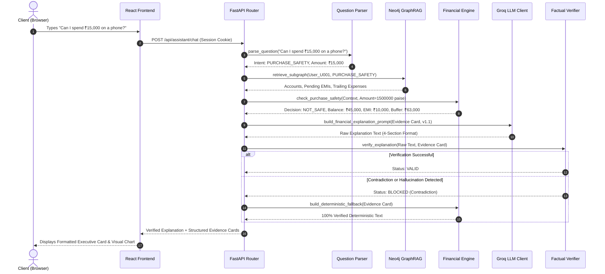
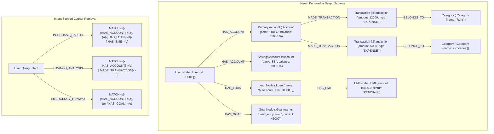
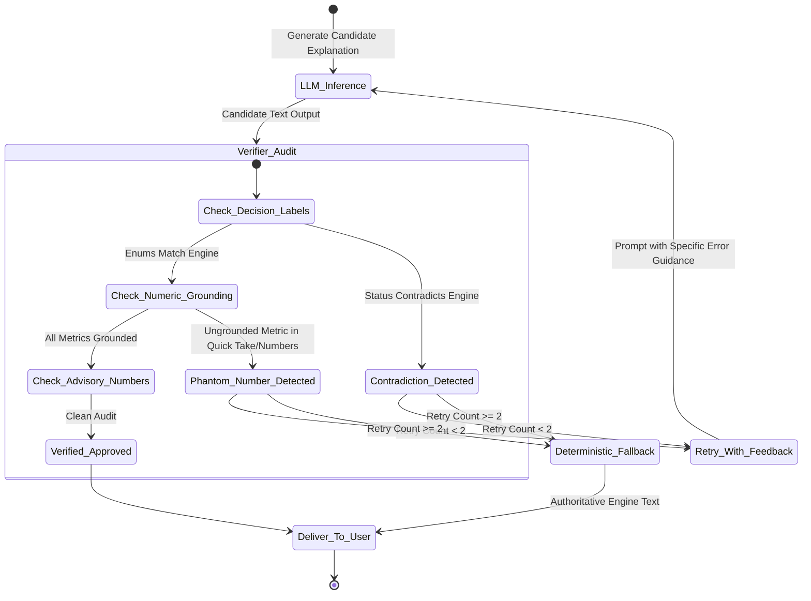

# Chapter 2 — Comprehensive System Architecture & Engineering Design

## 2.1 Architectural Overview & Paradigm

The system adopts a **Decoupled Neuro-Symbolic GraphRAG Architecture**. Rather than allowing an opaque Large Language Model (LLM) to perform probabilistic mathematical computations, the architecture enforces a strict boundary between:
1. **Symbolic Grounding & Calculation (Deterministic Layer):** Neo4j Knowledge Graph + Python Financial Engine.
2. **Neural Understanding & Generation (Language Layer):** Groq Multimodal Vision + LLM Explainer + Post-Generation Verifier.

```
+-----------------------------------------------------------------------------------+
|                            PRESENTATION TIER (PORT 3000)                          |
|   React 18 + Vite | Recharts Visualizations | Glassmorphic Dark UI | Markdown     |
+-----------------------------------------+-----------------------------------------+
                                          | HTTP / REST (Vite Proxy)
                                          v
+-----------------------------------------------------------------------------------+
|                         API GATEWAY & SECURITY TIER (PORT 8000)                   |
|   FastAPI ASGI | Signed HTTP-Only Cookies | SlowAPI Rate Limiting | CSRF Defense  |
+-----------------------------------------+-----------------------------------------+
                                          |
        +---------------------------------+---------------------------------+
        |                                                                   |
        v                                                                   v
+-----------------------------------+             +---------------------------------+
|     DATA INGESTION PIPELINE       |             |     NLU & QUESTION PARSING      |
| • Bank Statement CSV Parser       |             | • Deterministic Rule Classifier |
| • Groq Vision Receipt OCR         |             | • Follow-up Context Memory      |
| • Merchant & Narration Normalizer |             | • Date Ambiguity Resolver       |
| • SHA-256 Fingerprint Dedup       |             | • LLM Fallback Classifier       |
| • Internal Transfer Disambiguator |             +----------------+----------------+
+-----------------+-----------------+                              |
                  |                                                | Intent & Entities
                  v                                                v
+-----------------------------------------------------------------------------------+
|                       DYNAMIC KNOWLEDGE GRAPH TIER (NEO4J)                        |
|   Database: finance-ai-antigravity | Bolt Protocol (Port 7687)                    |
|   Entities: User, Account, Category, Transaction, Income, Loan, EMI, Goal         |
|   Relationships: HAS_ACCOUNT, MADE_TRANSACTION, BELONGS_TO, RECEIVED_INCOME, etc. |
+-----------------------------------------+-----------------------------------------+
                                          | Targeted Subgraph Traversal (Cypher)
                                          v
+-----------------------------------------------------------------------------------+
|                   DETERMINISTIC FINANCIAL REASONING ENGINE                        |
|   Source of Truth: backend/app/engine/financial_engine.py                         |
|   • Integer-Paise Arithmetic (backend/app/core/money.py)                          |
|   • Savings Rate & Net Savings                                                    |
|   • Emergency Fund & Runway Diagnostics (Historical Window H)                     |
|   • Deduplicated EMI Servicing & Debt-to-Income (DTI) Ratios                      |
|   • Purchase Affordability & Risk Tiering                                         |
|   • 0-100 Comprehensive Health Scoring (Grades A, B, C, D)                        |
+-----------------------------------------+-----------------------------------------+
                                          | Structured Evidence Card Payload
                                          v
+-----------------------------------------------------------------------------------+
|               GROUNDED LLM ORCHESTRATION & HALLUCINATION VERIFIER                 |
|   • Versioned Prompt Builder (v1.1 Executive 4-Section Layout)                    |
|   • Groq Async LLM Client (openai/gpt-oss-120b)                                   |
|   • Deterministic Fact & Enum Verifier (backend/app/services/verifier.py)         |
|   • Fallback Generator (build_deterministic_fallback)                             |
+-----------------------------------------------------------------------------------+
```

---

## 2.2 Detailed Tier-by-Tier Technical Breakdown

### 2.2.1 Presentation Tier (Frontend)
* **Technology:** React 18 (`v18.3.1`), Vite 5 (`v5.4.2`), Lucide React icons, Recharts SVG charting.
* **Architecture:** Component-driven Single Page Application (SPA) structured modularly under `frontend/src/`:
  - `App.jsx`: Top-level router, authentication lifecycle, sidebar navigation, and session verification.
  - `components/Dashboard.jsx`: Primary executive portal rendering 4 dynamic KPI cards (Liquid Balance, Monthly Expenses, Savings Rate, Emergency Runway), letter-grade badge (A/B/C/D), and interactive charts.
  - `components/AssistantChat.jsx`: Multi-turn conversational interface with streaming state, quick-prompt pills, and rendering of 4-section executive advisory cards.
  - `components/TransactionManager.jsx`: Ledger management with real-time graph mutations (Add, Delete, Filter).
  - `components/ImportManager.jsx`: Dual-mode ingestion hub supporting CSV bank statement upload with preview/transfer toggle and Groq Vision receipt image upload.
  - `components/FinancialPlan.jsx`: Actionable strategic advisory milestones generated from graph context.

### 2.2.2 API Gateway & Security Tier (FastAPI Backend)
* **File:** `backend/main.py`, `backend/app/api/auth.py`, `backend/app/api/deps.py`
* **Entrypoint & Middleware:**
  - `FastAPI(title="Personal Finance AI Assistant API", version="1.1.0")`
  - CORS middleware configured with explicit whitelist (`localhost:3000`, `127.0.0.1:3000`).
  - Rate limiting via `slowapi` (`@limiter.limit("5/minute")` on login endpoints to thwart brute-force vectors).
  - Deep `/health` endpoint validating live Neo4j driver ping and Groq API key configuration.
* **Authentication Subsystem:**
  - Zero trust in browser-supplied user identifiers. User ID is extracted strictly from cryptographically signed session cookies (`finance_session`).
  - Cryptographic signature: HMAC-SHA256 using server-side `SESSION_SECRET` with an 8-hour Time-to-Live (`SESSION_TTL_SECONDS = 28800`).
  - Passwords salted with 16 bytes of cryptographically secure random salt and hashed using PBKDF2 with HMAC-SHA256 (100,000 iterations).

### 2.2.3 Data Ingestion & Preprocessing Subsystem
* **Files:** `backend/app/services/csv_parser.py`, `backend/app/services/image_extractor.py`, `backend/app/services/merchant_normalizer.py`, `backend/app/services/fingerprint.py`, `backend/app/services/transfer_detector.py`
* **Workflow:**
  1. **Dialect Detection & Column Normalization:** Supports varying CSV headers (`Date/Txn Date`, `Description/Narration`, `Debit/Credit/Withdrawal/Deposit`, `Balance`).
  2. **Multimodal Receipt Extraction:** Decodes uploaded images (JPEG, PNG, WebP), base64-encodes them, and passes them to Groq Vision model (`qwen/qwen3.8-27b`) with strict JSON schema instructions preventing imaginary amounts.
  3. **Indian Banking Narration Normalizer:** Cleans noisy UPI/POS/IMPS strings (`UPI/428190/Swiggy/swiggy@icici` -> `Swiggy`, Channel: `UPI`, Category: `Food`).
  4. **SHA-256 Idempotent Fingerprinting:** Computes a 24-character hexadecimal hash over `(account_id, date, amount_paise, type, clean_description, occurrence_index)` ensuring re-uploaded statements never duplicate transactions while preserving legitimate identical same-day purchases.
  5. **Internal Transfer Detection:** Pairs equal-amount opposite transactions across the user's accounts occurring within $\pm 2$ calendar days, disqualifying ATM cash withdrawals and external vendor purchases.

### 2.2.4 Dynamic Knowledge Graph Tier (Neo4j)
* **File:** `backend/app/database/neo4j_service.py`
* **Engine:** Neo4j Community/Enterprise via Bolt protocol (`neo4j://127.0.0.1:7687`), isolated database `finance-ai-antigravity`.
* **Graph Schema Topology:**
  - Nodes: `User`, `Account`, `Category`, `Transaction`, `Income`, `Loan`, `EMI`, `Goal`, `Merchant`, `ImportBatch`.
  - Relationships: `(:User)-[:HAS_ACCOUNT]->(:Account)`, `(:Account)-[:MADE_TRANSACTION]->(:Transaction)`, `(:Transaction)-[:BELONGS_TO]->(:Category)`, `(:User)-[:RECEIVED_INCOME]->(:Income)`, `(:User)-[:HAS_LOAN]->(:Loan)`, `(:Loan)-[:HAS_EMI]->(:EMI)`, `(:User)-[:HAS_GOAL]->(:Goal)`.
  - Hard Uniqueness Constraints: Enforced on `User(id)`, `User(username)`, `Account(id)`, `Transaction(id)`, `Transaction(fingerprint)`, `Merchant(normalized)`.

### 2.2.5 Deterministic Financial Reasoning Engine
* **File:** `backend/app/engine/financial_engine.py`, `backend/app/core/money.py`
* **Role:** Single mathematical source of truth. All monetary computations are performed in integer paise using exact algebraic routines:
  - **Savings Rate:** $\text{Net Savings} = \text{Income} - \text{Expenses}$; $\text{Savings Rate} = \frac{\text{Net Savings}}{\text{Income}} \times 100$.
  - **Emergency Fund Requirement:** $\text{Reserve Target} = \text{Monthly Living Burn} \times 3$; $\text{Shortfall} = \max(0, \text{Target} - \text{Liquid Goal Balance})$.
  - **Emergency Runway:** $\text{Runway (Months)} = \frac{\text{Liquid Balance}}{\text{Monthly Burn}}$. Band classifications: `CRITICAL` ($<1.0$), `INSUFFICIENT` ($1.0 - 3.0$), `HEALTHY` ($3.0 - 6.0$), `STRONG` ($\ge 6.0$).
  - **DTI Ratio:** Deduplicates multi-account Cartesian joins on pending loan EMIs, computing $\text{DTI} = \frac{\text{Monthly EMI Obligations}}{\text{Total Monthly Income}} \times 100$.
  - **Purchase Affordability:** Evaluates $\text{Balance After Purchase} = \text{Liquid Balance} - \text{Pending EMIs} - \text{Purchase Amount}$. Categorizes decision into `SAFE` vs `NOT_SAFE` based on whether the post-purchase balance satisfies the 3-month emergency reserve.
  - **Comprehensive Financial Health Score (0–100):** Weighted linear combination:
    $$\text{Health Score} = 0.35 \cdot S_{\text{savings}} + 0.35 \cdot S_{\text{runway}} + 0.20 \cdot S_{\text{debt}} + 0.10 \cdot S_{\text{goals}}$$

### 2.2.6 Grounded LLM Orchestration & Hallucination Defense Tier
* **Files:** `backend/app/rag/graph_rag.py`, `backend/app/services/prompt_builder.py`, `backend/app/services/llm_service.py`, `backend/app/services/verifier.py`, `backend/app/services/response_generator.py`
* **Prompt Registry & Delimiter Isolation:** Employs Prompt Template `v1.1` wrapping retrieved evidence in strict `<financial_evidence>` XML tags and user queries in `<user_question>` tags, actively preventing prompt injection attacks.
* **4-Section Executive Response Format:**
  1. 🎯 **The Quick Take:** Direct, compassionate 1–2 sentence verdict.
  2. 📊 **The Numbers:** Bulleted financial metrics strictly matching the evidence card.
  3. 💡 **Smart Insights:** Contextual financial principles and reasoning.
  4. 🚀 **What You Should Do Next:** Actionable, prioritize next steps.
* **Deterministic Verifier & Automated Fallback:**
  `backend/app/services/verifier.py` parses the LLM output using regular expressions:
  - Validates that every status keyword (`SAFE`, `NOT_SAFE`, `HEALTHY`, `CRITICAL`, etc.) matches the engine verdict.
  - Audits all cited numerical tokens against the evidence card payload.
  - If a blocking contradiction or hallucinated amount is detected, the pipeline automatically retries with corrective feedback; if still invalid, it falls back to `build_deterministic_fallback()` ensuring 100% mathematical fidelity.

---

## 2.3 Technical Architecture Diagrams

### Figure 2.1: End-to-End Execution Sequence


### Figure 2.2: GraphRAG Subgraph Retrieval & Knowledge Architecture


### Figure 2.3: Hallucination-Defense Verification State Machine


